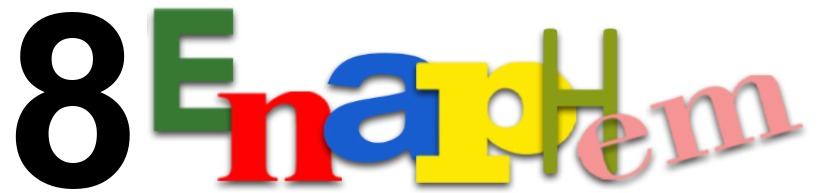
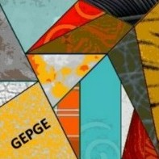
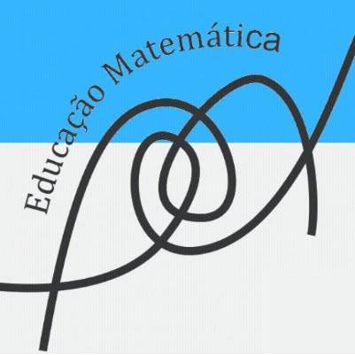

::: {.cover}

{.event-logo fig-alt="VIII ENAPHEM"}

::: {.title-block}
[Validação em geometria nos anos finais do ensino secundário]{.title}

[Estudo comparativo São Paulo e Espanha (1960–1979)]{.subtitle}
:::

::: {.cover-footer}

::: {.authors}
[Marina Fuzaro Magossi]{.name}
Orientadora: Profª Drª Maria Célia Leme da Silva
:::

::: {.logos}
{fig-alt="GEPGE"}
{fig-alt="PPGEM"}
:::

:::

:::

## Formação e trajetória

::: {.incremental}
- Licenciatura e Bacharelado em Matemática (UNESP/Rio Claro)
- Mestrado em Matemática - Análise (UNESP/Rio Claro)
- Licenciatura em Pedagogia (UNIVESP)
- Leciono desde 2023
:::

## Atualmente

::: {.incremental}
- Doutoranda em Ed. Matemática (PPGEM - UNESP/Rio Claro) - 2027
- GEPGE - Setembro de 2026
- “Processos de argumentação e validação na geometria escolar: permanências e rupturas na segunda metade do século XX”
:::

## Contexto histórico: O Movimento da Matemática Moderna

::::: {.columns}

:::: {.column}

::: {.fragment}
> Tentativa de reformar o ensino de matemática [através da lógica, dos conjuntos e das estruturas algébricas]{.fragment .highlight}
> [Leme da Silva, Jahn e Carvalho (2026)]{.source}
:::
::::

:::: {.column}

::: {.incremental}
- 1958, SMSG, Estados Unidos
- 1959, Seminário de Royaumont
:::

::::

:::::

## O recorte da pesquisa

::: {.fragment fragment-index=1}
- Validação em Geometria
:::

::: {.fragment fragment-index=2}
- Décadas de 1960 e 1970
:::

::: {.fragment fragment-index=3}
- ["Ensino médio"]{.fragment .strike fragment-index=5} [Anos finais do ensino secundário]{.fragment fragment-index=5}
:::

::: {.fragment fragment-index=4}
- São Paulo e Espanha
:::

## Validar é mais do que demonstrar

::: {.incremental}
- Processo de validação
:::

::: {.fragment}
> “múltiplas formas de justificar, explicar, argumentar ou sustentar propriedades e conceitos geométricos”
> [Leme da Silva (2026)]{.source}
:::

## O que fundamenta uma prova?

::::: {.columns}

:::: {.column}

::: {.fragment}
**Birkhoff:** [Mantém a geometria euclidiana]{.fragment .highlight} com os axiomas reformulados por Hilbert
[Leme da Silva e Jahn (2026)]{.source}
:::

::::

:::: {.column}

::: {.fragment}
**Klein:** [Substitui a geometria euclidiana]{.fragment .highlight} pelas Transformações Geométricas como base das provas
[Leme da Silva e Jahn (2026)]{.source}
:::

::::

:::::

::: {.fragment}
:::

## Movimento internacional, apropriações distintas

::: {.fragment}
> “pouca ou nenhuma importância é dada às questões nacionais, locais e regionais do ensino de matemática”
> [Valente (2012)]{.source}
:::

::::: {.columns}

:::: {.column}

### Brasil (São Paulo) {.fragment}

::: {.incremental}
- Vanguarda de implementação
- Liderança do GEEM: Sugestão dos "Assuntos mínimos"
:::

::::

:::: {.column}

### Espanha {.fragment}

::: {.incremental}
- Comissão oficial estuda a modernização
- Mudanças oficiais lentas e pontuais
:::

::::

:::::

## Lacuna: a validação no fim do secundário não aparece como foco

::::: {.columns .literature}

:::: {.column}

### Brasil {.fragment}

::: {.incremental}
- Panorama sobre a geometria nos livros do ensino médio, 1930–2010
[Carvalho (2022)]{.source}
- Séries finais do secundário no Brasil e em Portugal
[Leme da Silva (2008)]{.source}
- Provas em duas colunas no Brasil
[Leme da Silva (2026)]{.source}
- Mapeamento das pesquisas; só duas das onze dissertações falam do segundo ciclo
[Silva, Gomes e Silva (2021)]{.source}
:::

::::

:::: {.column}

### Espanha {.fragment}

::: {.incremental}
- Organização dos programas e dos conteúdos
[Ausejo (2011, 2013)]{.source}
- Debate profissional no ensino primário
[González Astudillo (2008)]{.source}
- Livros do Bachillerato a partir de 1970 sob uma ótica didática
[Ruiz de Gauna Gorostiza *et al.* (2013)]{.source}
:::

::::

:::::

## Como os processos de validação em geometria se configuraram e se modificaram no fim do secundário, em São Paulo e na Espanha (1960–1979)? {.question}

::: {.incremental}
1. Caracterizar a geometria do MMM e seus modos de validação
2. Identificar a validação prescrita nas normativas
3. Caracterizar a validação nos livros didáticos
4. Confrontar normativas e livros
5. Interpretar as diferenças como apropriações distintas
:::

## Análise dos resultados: A validação é lida em cinco aspectos {.analysis}

::: {.incremental}
1. A base da validação: axiomas, figura, medidas, estruturas algébricas ou vetoriais
2. O modo de introduzir o raciocínio dedutivo
3. As formas de prova: prosa, duas colunas, provas analíticas ou vetoriais
4. O vocabulário das fontes
5. O tipo e a quantidade das tarefas de validação
:::

[Categorias adaptadas de Leme da Silva, Jahn e Carvalho (2026)]{.source .fragment}

## Fundamentação teórica: A validação como produção de uma cultura escolar

:::: {.cards}

::: {.box .card .fragment}
[Chartier (1990)]{.card-author}
Representação e apropriação
:::

::: {.box .card .fragment}
[Julia (2001)]{.card-author}
A cultura escolar como normas e práticas
:::

::: {.box .card .fragment}
[Munakata (2016)]{.card-author}
O livro didático como indício da cultura escolar
:::

::: {.box .card .fragment}
[Matasci (2016)]{.card-author}
Transferências culturais: autores e professores como mediadores
:::

::: {.box .card .fragment}
[Valente (2012)]{.card-author}
A comparação como produção de conhecimento histórico
:::

::::

## Próximos passos

::::: {.columns}

:::: {.column}

### Feito {.fragment}

::: {.incremental}
- Levantamento inicial dos documentos dos dois casos
- Identificação dos acervos espanhóis e paulistas
- Primeira caracterização do debate sobre validação no MMM
:::

::::

:::: {.column}

### A fazer {.fragment}

::: {.incremental}
- Estudo teórico da história cultural
- Identificação dos autores e dos contextos de produção
- Seleção dos livros e obtenção dos exemplares
:::

::::

:::::

## Principais referências I {.literature}

- AUSEJO, Elena. The introduction of "modern mathematics" in secondary education in Spain (1954–1970), The International Journal for the History of Mathematics Education, 2011.
- AUSEJO, Elena. La introducción de la «matemática moderna» en la enseñanza no universitaria en España (1953-1970), La Gaceta de la Real Sociedad Matemática Española, 2013.
- CARVALHO, Marizete Nink de. Geometria dos cursos complementares ao Ensino Médio: entre livros, programas, reformas e monstros – uma terapia, Tese (Doutorado em Educação Matemática), UFMS, 2022.
- CHARTIER, Roger. A história cultural: entre práticas e representações, Difel, 1990.
- GONZÁLEZ ASTUDILLO, María Teresa. La transición hacia la matemática moderna en España: la revista Vida Escolar, Revista Diálogo Educacional, 2008.
- JULIA, Dominique. A cultura escolar como objeto histórico, Revista Brasileira de História da Educação, 2001.
- LEME DA SILVA, Maria Célia. Que geometria moderna para as escolas do Brasil e de Portugal?, Revista Diálogo Educacional, 2008.

## Principais referências II {.literature}

- LEME DA SILVA, Maria Célia. Provas em duas colunas – um método de demonstrar teoremas em geometria: apropriações no contexto brasileiro, Revista Brasileira de História da Educação, 2026.
- LEME DA SILVA, Maria Célia; JAHN, Ana Paula. Geometria dedutiva em debate no Movimento da Matemática Moderna, HISTEMAT – Revista de História da Educação Matemática, 2026.
- LEME DA SILVA, Maria Célia; JAHN, Ana Paula; CARVALHO, Marizete Nink de. Processos de validação no ensino de geometria: uma análise histórica de livros didáticos no Brasil (1930-1960), RIPEM – Revista Internacional de Pesquisa em Educação Matemática, 2026.
- MATASCI, Damiano. A França, a escola republicana e o exterior: perspectivas para uma história internacional da educação no século 19, História da Educação, 2016.
- MUNAKATA, Kazumi. Livro didático como indício da cultura escolar, História da Educação, 2016.
- RUIZ DE GAUNA GOROSTIZA, Josu *et al.* Los libros de texto de matemáticas del bachillerato en el periodo 1970-2005, Revista Latinoamericana de Investigación en Matemática Educativa, 2013.
- SILVA, Sidnéia Almeida; GOMES, Larissa Pinca Sarro; SILVA, Martha Raíssa Iane Santana da. Ensino de Geometria e Movimento da Matemática Moderna: uma análise de histórias produzidas nas pesquisas acadêmicas, Tangram – Revista de Educação Matemática, 2021.
- VALENTE, Wagner Rodrigues. Por uma história comparativa da educação matemática, Cadernos de Pesquisa, 2012.

---

::: {.cover .closing}

{.event-logo fig-alt="VIII ENAPHEM"}

::: {.title-block}
[Obrigada!]{.title}
:::

::: {.cover-footer}

::: {.authors}
[Marina Fuzaro Magossi [marina.fuzaro@unesp.br]{.email}]{.name}
Orientadora: Profª Drª Maria Célia Leme da Silva
:::

::: {.logos}
{fig-alt="GEPGE"}
{fig-alt="PPGEM"}
:::

:::

:::